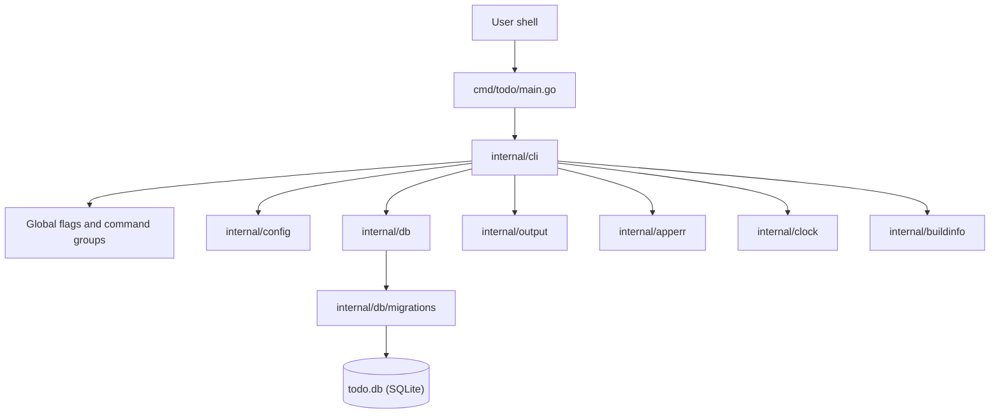

# Technical Specification: CLI Foundation and Local Storage

## 1. Technical Overview

### What

This feature delivers a Go module named `todo` that builds a single static `todo` binary. The binary exposes a Cobra command tree, global flags (`--json`, `--db`, `--no-color`, `--help`, `--version`), a deterministic exit-code contract (`0` success, `1` user/validation error, `2` system/unexpected error), and a local SQLite store that is created automatically on first use.

The store uses schema v1 with `categories`, `tags`, `tasks`, `task_tags`, and `schema_migrations`. It runs with WAL journaling, foreign keys enabled, a 5-second busy timeout, and a transactionally applied, versioned migration runner. Every command that needs storage resolves the database path, creates the data directory and file with restrictive permissions, applies connection pragmas, checks the schema version, applies pending migrations, and only then runs the command.

### Why

This is the Foundation feature for F02–F10. It establishes the package boundaries, error taxonomy, output conventions, path resolution, clock abstraction, and data schema that every later command reuses. Locking these contracts once prevents five waves of rework and gives later features a stable base for categories, tags, capture, completion, listing, editing, overdue reports, search, and soft delete.

### Requirements

- Binary name is `todo`; no runtime dependencies beyond the operating system.
- SQLite 3.35 or newer, WAL journal mode, foreign keys enabled, 5-second busy timeout.
- Database file created with `0600`; data directory created with `0700`.
- Supports at least 100,000 tasks without schema changes.
- Command startup completes in under 150 ms on reference hardware.
- Concurrent invocations are safe: write contention retries up to 3 times with 100 ms backoff before failing.
- Schema version is tracked and checked on every invocation; a database newer than the binary is refused.
- `--json` produces one JSON document per command on stdout, with errors kept on stderr.
- Automatic first-run initialization of the data directory and schema.

### Scope

**Included:**
- Go module, `make build`, and a single `todo` binary using a Cobra command tree.
- Data directory and database path resolution.
- First-run creation of the data directory (`0700`) and database file (`0600`).
- SQLite open sequence with WAL, foreign keys, busy timeout, and a single connection.
- Schema v1: `categories`, `tags`, `tasks`, `task_tags`, `schema_migrations`, plus indexes and referential actions.
- Versioned migration runner backed by `schema_migrations`, applied transactionally.
- Schema version check with a newer-than-binary refusal.
- Global flags: `--json`, `--db`, `--no-color`, `--help`, `--version`.
- Exit codes `0`, `1`, `2`, with a typed error taxonomy.
- Shared output contract: text lines, tables, JSON documents, notes, errors, and color policy.
- Lazy corruption detection and the documented corrupt-database error.
- Write-contention retry policy around transactions.
- `todo --version` text output and a `--json` variant.
- Help grouping scaffold for task, organization, and maintenance commands.
- Clock abstraction for later date-sensitive features.

**Deferred (Full Scope additions, not covered here):**
- `todo completion <shell>` for bash, zsh, and fish.
- `todo doctor` diagnostics.
- `config.toml` defaults for list view, date format, and color mode.

**Excluded (PRD Section 7):**
- Task, category, and tag commands (F02–F10).
- Accounts, synchronization, notifications, GUI/TUI, import/export, HTTP API, encryption, and distribution packaging.

**Provides to later features:**
- Schema v1 and the `schema_migrations` mechanism.
- Database open, pragma, retry, and transaction helpers.
- Path resolution and first-run initialization.
- Typed errors and exit-code mapping.
- Output printer and JSON conventions.
- Clock abstraction.
- Command group identifiers so later commands attach without restructuring help.

### UX Flows

- **First run:** the first command that needs storage creates the data directory and database silently. No setup banner is printed; only the command result appears.
- **Version:** `todo --version` prints `todo v0.1.0 (schema 1)` and exits 0 without opening the database. With `--json`, it prints a single JSON object.
- **Help:** `todo --help` prints usage and the command groups. Bare `todo` prints the same help and exits 0 without opening the database.
- **Validation error:** a single line prefixed with `error:` goes to stderr and the process exits 1.
- **Unexpected failure:** `error: unexpected failure: <detail>` goes to stderr and the process exits 2.
- **Read output:** a table on stdout, or one JSON document on stdout when `--json` is set.
- **Color:** ANSI styling is disabled by `--no-color` and automatically disabled when stdout is not a TTY.

## 2. Architecture Impact

### Affected Components

- `cmd/todo/main.go` — process entry point, signal-aware context, exit code handoff.
- `internal/cli` — Cobra root command, global flags, command groups, runtime wiring, error-to-exit mapping.
- `internal/config` — database path resolution and display formatting.
- `internal/db` — SQLite open sequence, pragmas, retries, corruption handling, migration runner.
- `internal/db/migrations` — embedded SQL migration files.
- `internal/output` — text, table, JSON, note, error, and color helpers.
- `internal/apperr` — user/system error types and exit-code classification.
- `internal/clock` — time abstraction for later date-sensitive features.
- `internal/buildinfo` — version and schema-version constants.

### Component Diagram



### Command Execution Flow

1. `main` creates a context that is cancelled on `SIGINT`/`SIGTERM` and calls `cli.Execute`.
2. Cobra parses global flags. `--help` is handled by Cobra before any hook.
3. The root persistent pre-run builds the output printer from `--json` and `--no-color`.
4. If `--version` is set, the version is printed and execution stops without touching the database.
5. If the root command is executed with no subcommand, grouped help is printed and execution stops without touching the database.
6. For a subcommand, the pre-run resolves the database path, ensures the parent directory, opens the database, applies pragmas, checks the schema version, applies pending migrations, and attaches the runtime to the command context.
7. The command runs and writes to stdout through the printer.
8. Errors are classified by `internal/apperr`; the printer writes the documented line to stderr; the process exits with `0`, `1`, or `2`.
9. The database is closed with a deferred call before the process exits.

### Package Dependency Rules

| Package | May import | Must not import |
|---------|------------|-----------------|
| `cmd/todo` | `internal/cli` | any other internal package directly |
| `internal/cli` | `github.com/spf13/cobra`, `internal/config`, `internal/db`, `internal/output`, `internal/apperr`, `internal/clock`, `internal/buildinfo` | `cmd/todo` |
| `internal/db` | `modernc.org/sqlite`, `internal/apperr`, `internal/clock` | `internal/cli`, `internal/output` |
| `internal/config` | `internal/apperr` | `internal/db`, `internal/cli` |
| `internal/output` | `golang.org/x/term` | `internal/cli`, `internal/db` |
| `internal/apperr` | standard library only | any other internal package |
| `internal/clock` | standard library only | any other internal package |
| `internal/buildinfo` | standard library only | any other internal package |

These rules keep the Foundation reusable and prevent later features from creating import cycles.

## 3. Technical Decisions

### Decision Log

| Decision | Chosen Approach | Alternative Considered | Trade-off |
|----------|----------------|------------------------|-----------|
| Feature scope | Core Scope only | Core + Full Scope additions | Shell completions, `doctor`, and `config.toml` are deferred; the Foundation stays small for waves 2–5. |
| Go module path | `todo` | `github.com/<owner>/todo` | Short local imports; the module must be renamed if it is ever published. |
| SQLite driver | `modernc.org/sqlite` | `mattn/go-sqlite3` | Pure Go and a static binary; slightly slower than the cgo driver and a larger dependency. |
| Migration runner | Custom embedded-SQL runner | `goose`, `golang-migrate` | We own the `schema_migrations` contract and error messages; we also own the runner code. |
| Package layout | Layered `cmd/` + `internal/` packages | Flat `package main` | More files and explicit boundaries; easier to test and extend across F02–F10. |
| Output layer | `text/tabwriter` + `encoding/json` + `golang.org/x/term` | `olekukonko/tablewriter` | Minimal dependencies and full control of width-based column hiding later; plain tables by default. |
| Testing | stdlib `testing` + `testify`, real temp SQLite files | `go-sqlmock` | Slower tests, but real WAL, foreign-key, locking, and migration behavior. |
| Schema shape | `AUTOINCREMENT` ids, derived status, `TEXT` dates | Explicit status column, epoch integers | Status cannot drift and dates are auditable; integer date math must happen in Go. |
| Path precedence | `--db` > `TODO_DB_PATH` > XDG > home fallback | Environment before flag | The explicit flag always wins; environment remains available for CI. |
| Version source | ldflags injection + schema constant | Hardcoded version | Release metadata follows git tags; an untagged build prints `dev`. |
| JSON errors | Plain-text errors on stderr | JSON error objects | Matches the documented messages and keeps stdout empty on failure; scripts must parse text errors. |
| Write retry | 1 initial attempt + 3 retries around the transaction | 3 total attempts | Literal reading of “retries up to 3 times”; worst case is longer under contention. |
| Corruption check | Lazy, only on corruption-class errors | `quick_check` on every open | Normal startup stays fast; corruption is reported when SQLite surfaces it. |
| Connection pool | Maximum one open connection | Multiple connections | Avoids in-process lock contention; concurrent invocations rely on separate processes and WAL. |
| Go baseline | Go 1.23 or newer | Older Go | Modern standard library and tooling; requires a current toolchain. |

### Assumptions

- This feature targets Unix-like operating systems. Windows path conventions are out of scope.
- The implementation environment must provide Go 1.23 or newer.
- Existing directories and database files keep their current permissions. Only newly created artifacts receive `0700`/`0600`.
- `TODO_DB_PATH` set to an empty string is treated as unset. An explicitly supplied empty `--db ""` is a user error.
- `--json` changes only successful stdout output. Errors remain plain text on stderr, and help remains text.
- Bare `todo` prints help and exits 0 without creating or opening the database.
- `--version` bypasses database initialization entirely, so it works with a corrupt or absent database.
- A non-empty database without `schema_migrations` is refused as “not a todo database” rather than being overwritten.
- `PRAGMA user_version` is kept in sync after each migration for external tooling. `schema_migrations` remains the source of truth.
- WAL and SHM sidecar files are best-effort `0600`. This is not an acceptance criterion because SQLite controls their creation timing.
- Category `COLLATE NOCASE` uniqueness is ASCII-only. Unicode case folding would require a future migration.
- Title and notes length validation belong to F04. F01 stores the columns without database `CHECK` constraints.
- Table column width detection and truncation belong to F06. F01 provides only a basic aligned-table helper.
- Context cancellation (for example, `SIGINT`) is reported as `error: interrupted.` with exit code 2.

## 4. Component Overview

### Application and Build

| File Path | New/Modified | Purpose | Key Responsibilities |
|-----------|--------------|---------|----------------------|
| `go.mod` | New | Module definition | Declares `module todo`, the Go baseline, and direct dependencies. |
| `go.sum` | New | Dependency checksums | Pins transitive dependency content. |
| `Makefile` | New | Build automation | Provides `build`, `test`, `test-race`, `cover`, `lint`, `fmt`, `install`, and `clean`; injects the version through ldflags. |
| `.gitignore` | New | Repository hygiene | Ignores `bin/`, coverage output, and local database artifacts. |
| `README.md` | New | Developer entry point | Documents build, test, and first-run usage. |
| `cmd/todo/main.go` | New | Process entry point | Builds a signal-aware context, calls `cli.Execute`, and exits with the returned code. |

### CLI Layer

| File Path | New/Modified | Purpose | Key Responsibilities |
|-----------|--------------|---------|----------------------|
| `internal/cli/root.go` | New | Cobra root | Defines the root command, persistent flags, output writers, and the persistent pre-run sequence. |
| `internal/cli/groups.go` | New | Command groups | Declares the task, organization, and maintenance group identifiers and titles. |
| `internal/cli/execute.go` | New | Execution boundary | Runs Cobra with silenced errors, classifies failures, prints the documented stderr line, and returns the exit code. |
| `internal/cli/version.go` | New | Version surface | Handles `--version` in text and JSON form before any database work. |
| `internal/cli/runtime.go` | New | Runtime wiring | Carries config, store, printer, and clock through the command context for later features. |

### Configuration and Runtime Services

| File Path | New/Modified | Purpose | Key Responsibilities |
|-----------|--------------|---------|----------------------|
| `internal/config/config.go` | New | Path resolution | Applies the precedence chain, expands `~/`, normalizes to an absolute path, validates empty input, and formats display paths. |
| `internal/clock/clock.go` | New | Time abstraction | Defines the clock interface, the system implementation, and local-day helpers for later features. |
| `internal/output/printer.go` | New | Output contract | Writes text lines, JSON documents, notes, errors, and aligned tables to the configured writers. |
| `internal/output/color.go` | New | Color policy | Provides ANSI helpers and decides whether color is enabled from the flag and TTY state. |
| `internal/apperr/apperr.go` | New | Error taxonomy | Defines user and system errors, wraps unexpected failures, classifies Cobra errors, and maps errors to exit codes. |
| `internal/buildinfo/buildinfo.go` | New | Build metadata | Holds the ldflags-injected version, the schema-version constant, and the formatted version string. |

### Storage Layer

| File Path | New/Modified | Purpose | Key Responsibilities |
|-----------|--------------|---------|----------------------|
| `internal/db/store.go` | New | Store facade | Opens the database, holds the connection, exposes the write-transaction helper, and closes cleanly. |
| `internal/db/pragmas.go` | New | Connection setup | Applies WAL, foreign keys, busy timeout, synchronous mode, and single-connection limits. |
| `internal/db/retry.go` | New | Contention handling | Classifies busy/locked errors, applies the 1+3 retry policy with 100 ms backoff, and returns the documented exhaustion error. |
| `internal/db/corruption.go` | New | Corruption handling | Detects corruption-class errors, runs the confirmation check, and returns the documented error. |
| `internal/db/migrate.go` | New | Migration runner | Embeds migrations, bootstraps the version table, reads the effective version, refuses newer databases, and applies pending migrations transactionally. |

### Schema and Migrations

| Migration File | Tables Affected | Operation | Notes |
|----------------|-----------------|-----------|-------|
| `internal/db/migrations/0001_initial.sql` | `categories`, `tags`, `tasks`, `task_tags` | CREATE | Creates the four domain tables and five indexes. The runner creates `schema_migrations` separately. |

### Test Support

| File Path | New/Modified | Purpose | Key Responsibilities |
|-----------|--------------|---------|----------------------|
| `internal/testutil/db.go` | New | Database fixtures | Creates temporary databases, applies migrations, and seeds rows for tests. |
| `internal/testutil/clock.go` | New | Clock fixtures | Provides a controllable clock for date-sensitive tests. |
| `internal/cli/cli_test.go` | New | In-process CLI tests | Registers a synthetic storage-using command to exercise first-run initialization and command contracts. |
| `test/integration/binary_test.go` | New | Black-box binary tests | Builds and executes the binary for version, help, unknown command/flag, and exit-code checks. |
| `test/integration/perf_test.go` | New | Performance checks | Seeds 100,000 tasks and benchmarks startup plus the representative today query. |

## 5. CLI Contracts

This section is the API surface for a command-line product: invocation shapes, flags, exit codes, error lines, JSON conventions, and initialization behavior.

### Root Command

| Invocation | Behavior | Stdout | Exit | Opens database |
|------------|----------|--------|------|----------------|
| `todo` | Print grouped help | Help text | 0 | No |
| `todo --help`, `todo -h` | Print grouped help | Help text | 0 | No |
| `todo --version` | Print version | Version line or JSON | 0 | No |
| `todo <command> [flags]` | Run a registered command | Command output | Per command | Yes |
| `todo <unknown>` | Unknown command | Empty | 1 | No |
| `todo --bogus` | Unknown flag | Empty | 1 | No |

The root command has `SilenceErrors` and `SilenceUsage` enabled so that only the documented single-line error is printed. The root command has a `RunE` that prints help, which makes bare `todo` a successful, database-free invocation.

### Global Flags

| Flag | Type | Default | Behavior |
|------|------|---------|----------|
| `--json` | bool | `false` | Emit one JSON document on stdout for successful read commands. Errors remain text on stderr. |
| `--db` | string | `""` | Path to the SQLite database file. Takes precedence over `TODO_DB_PATH` and the default location. |
| `--no-color` | bool | `false` | Disable ANSI styling. Color is also disabled when stdout is not a TTY. |
| `--help`, `-h` | bool | `false` | Print help and exit 0. Handled by Cobra before any database work. |
| `--version` | bool | `false` | Print the version and exit 0. Implemented as a persistent flag so it can honor `--json` and bypass database work. |

`--version` is deliberately not Cobra's built-in version flag. Cobra's built-in version handling prints a template before the persistent pre-run and cannot honor `--json` or a custom JSON document. The manual flag is checked at the start of the persistent pre-run, before path resolution or database access.

### Version Surface

Text output is exactly:

```text
todo v0.1.0 (schema 1)
```

The format is `todo <version> (schema <N>)`. A build without a version stamp prints `todo dev (schema 1)`. The version comes from `-ldflags -X todo/internal/buildinfo.Version=<value>`; the schema number is the compile-time supported schema version.

JSON output for `todo --version --json` is exactly:

```json
{"version":"v0.1.0","schema_version":1}
```

| Field | Type | Description |
|-------|------|-------------|
| `version` | string | Binary version without the `todo ` prefix; `dev` when untagged. |
| `schema_version` | integer | Highest schema version supported by this binary. |

Both forms exit 0, write to stdout, and never open the database. Flag order does not matter.

### Help Grouping

| Group ID | Help Title | Owner |
|----------|------------|-------|
| `task` | `Task commands` | F04–F10 task commands |
| `organization` | `Organization commands` | F02 and F03 commands |
| `maintenance` | `Maintenance commands` | F10 delete, restore, and deleted commands |

F01 registers the three groups on the root command. Later features attach commands by setting `GroupID` on their Cobra command. Cobra renders only groups that contain at least one command, so F01's help shows usage and global flags while the group sections appear as later features land.

### Exit Codes

| Code | Meaning | Examples |
|------|---------|----------|
| `0` | Success | Help, version, successful reads and writes, non-fatal notes. |
| `1` | User or validation error | Bad flag, unknown command, invalid path, unwritable data directory, newer schema, validation failure. |
| `2` | Unexpected or system error | Locked database after retries, corrupt database, failed migration, internal failure. |

### Error Output Contract

- Every failure writes exactly one line to stderr in the form `error: <message>` followed by a newline.
- Stdout stays empty on failure. Partial output is never flushed before a failure.
- No usage dump is printed after an error. The user can run `--help` explicitly.
- Unexpected failures use the prefix `error: unexpected failure: <detail>`.
- Non-fatal notices use `note: <message>` on stderr and do not change the exit code.
- `--json` does not change error formatting. JSON is a success-output mode only.
- Cobra-originated errors (`unknown command`, `unknown flag`, `invalid argument`, `required flag(s)`) are classified as user errors and exit 1.
- A cancelled context is reported as `error: interrupted.` with exit 2.

### Error Catalog

| Condition | Exit | Exact stderr line |
|-----------|------|-------------------|
| Data directory cannot be created because of permissions | 1 | `error: cannot create data directory ~/.local/share/todo: permission denied. Set TODO_DB_PATH to a writable location.` |
| Data directory cannot be created for another reason | 1 | `error: cannot create data directory <path>: <detail>. Set TODO_DB_PATH to a writable location.` |
| Database file cannot be created | 1 | `error: cannot create database file at <path>: <detail>.` |
| Database remains locked after retries | 2 | `error: database is locked by another process; try again.` |
| Database schema is newer than the binary | 1 | `error: database schema v3 is newer than supported v1. Upgrade todo before using this database.` |
| Database file is corrupt | 2 | `error: database file at <path> failed the integrity check. Back up the file before retrying.` |
| Database is not a todo database | 2 | `error: database file at <path> is not a todo database. Back up the file before retrying.` |
| Migration fails | 2 | `error: migration to v2 failed: <reason>. Database left unchanged.` |
| Unexpected internal failure | 2 | `error: unexpected failure: <detail>` |
| Unknown command | 1 | `error: unknown command "<name>" for "todo"` |
| Unknown flag | 1 | `error: unknown flag: --<name>` |
| Explicit empty `--db` | 1 | `error: --db requires a non-empty path.` |
| Neither XDG nor HOME can resolve a default path | 1 | `error: cannot resolve data directory: neither XDG_DATA_HOME nor HOME is set. Set TODO_DB_PATH or use --db.` |
| Context cancelled | 2 | `error: interrupted.` |

Paths in error messages use the display form: a path under the user's home directory is rendered with a leading `~`, and all other paths are absolute.

### JSON Output Conventions

- A successful `--json` command writes exactly one JSON document to stdout, followed by a newline.
- Encoding is compact (no indentation) and HTML escaping is disabled so `<`, `>`, and `&` remain literal.
- Object keys use `snake_case`.
- Timestamps use RFC3339 in UTC, for example `2026-11-11T14:02:00Z`.
- Calendar dates use `YYYY-MM-DD`.
- Absent optional values are `null`; list values are `[]`, never `null`.
- There is no global envelope. Each command defines its own top-level shape. F01 defines only the version object; later features define task objects, arrays, and report objects.
- Errors are never JSON. A failing command leaves stdout empty and writes the documented text line to stderr.

### Startup and Initialization Contract

For every command that needs storage, the persistent pre-run performs these steps in order:

1. Build the output printer from `--json` and `--no-color`.
2. If `--version` is set, print the version and stop with exit 0.
3. If the root command is running with no subcommand, print help and stop with exit 0.
4. Resolve the database path using the precedence rules below.
5. Create the parent directory with `0700` if it does not exist.
6. Create the database file with `0600` if it does not exist. Existing files are not modified.
7. Open the SQLite connection and configure the connection pool.
8. Apply the connection pragmas.
9. Inspect the database: a fresh database is initialized; an existing todo database is checked for a newer schema and upgraded if needed; a non-empty database without `schema_migrations` is refused.
10. Attach the runtime (config, store, printer, clock) to the command context.
11. Run the command.
12. Close the database before returning, including on error paths.

Initialization is silent. No banner, no progress output, and no setup prompt is printed.

### Database Path Resolution

| Priority | Source | Semantics |
|----------|--------|-----------|
| 1 | `--db <path>` | Full path to the database file. If the flag is explicitly supplied but empty, exit 1. |
| 2 | `TODO_DB_PATH` | Full path to the database file. An empty value is treated as unset. |
| 3 | `$XDG_DATA_HOME/todo/todo.db` | Used when `XDG_DATA_HOME` is set and absolute. |
| 4 | `$HOME/.local/share/todo/todo.db` | Fallback when XDG is unset, empty, or relative. |

Additional rules:

- A leading `~/` is expanded with the user's home directory.
- Relative paths are converted to absolute paths before use.
- `$XDG_DATA_HOME` is ignored when it is relative, per the XDG Base Directory specification.
- If neither XDG nor HOME can supply a default, exit 1 with the documented resolution error.
- Custom paths skip the XDG directory entirely. Only the parent directory of the chosen database file is created.
- Error messages render paths under the home directory with `~`; other paths are shown absolute.

### Write Contention Contract

- All multi-statement writes go through one transaction helper exposed by the store.
- The helper attempts the transaction once and retries up to three more times, for a maximum of four attempts.
- Retries happen only for SQLite `SQLITE_BUSY` and `SQLITE_LOCKED` errors, including extended codes.
- The backoff is a fixed 100 ms between attempts and is cancelled if the command context is cancelled.
- Application, validation, and constraint errors returned by the transaction body are not retried; the transaction is rolled back and the error is returned immediately.
- Each attempt still honors the 5-second SQLite busy timeout.
- Exhausting the retries returns `error: database is locked by another process; try again.` with exit 2.
- Migration transactions use the same helper so that an upgrade competing with another process waits and retries consistently.

## 6. Data Model

Schema v1 is the shared base for F02–F10. The runner creates `schema_migrations`; the initial migration creates the four domain tables and their indexes.

### Table: `schema_migrations`

| Column | Type | Nullable | Default | Description |
|--------|------|----------|---------|-------------|
| `version` | `INTEGER` | No | — | Applied migration version. Primary key. |
| `applied_at` | `TEXT` | No | — | RFC3339 UTC timestamp recorded when the migration committed. |

### Table: `categories`

| Column | Type | Nullable | Default | Description |
|--------|------|----------|---------|-------------|
| `id` | `INTEGER` | No | autoincrement | Primary key. Monotonic and never reused. |
| `name` | `TEXT` | No | — | Display name, 1–40 characters. Unique with `COLLATE NOCASE`. |
| `created_at` | `TEXT` | No | — | RFC3339 UTC creation timestamp. |
| `updated_at` | `TEXT` | No | — | RFC3339 UTC last-update timestamp. |

### Table: `tags`

| Column | Type | Nullable | Default | Description |
|--------|------|----------|---------|-------------|
| `id` | `INTEGER` | No | autoincrement | Primary key. Monotonic and never reused. |
| `name` | `TEXT` | No | — | Normalized lowercase tag name. Unique. |
| `created_at` | `TEXT` | No | — | RFC3339 UTC creation timestamp. |

### Table: `tasks`

| Column | Type | Nullable | Default | Description |
|--------|------|----------|---------|-------------|
| `id` | `INTEGER` | No | autoincrement | Primary key. Monotonic and never reused, including after purge. |
| `title` | `TEXT` | No | — | Task title. Length is validated by F04. |
| `notes` | `TEXT` | No | `''` | Optional notes. Length and newlines are validated by F04. |
| `due_date` | `TEXT` | Yes | `NULL` | Local calendar date in `YYYY-MM-DD` form. `NULL` means undated. |
| `category_id` | `INTEGER` | Yes | `NULL` | Reference to `categories(id)` with `ON DELETE RESTRICT`. `NULL` means uncategorized. |
| `completed_at` | `TEXT` | Yes | `NULL` | RFC3339 UTC completion timestamp. `NULL` means open. |
| `deleted_at` | `TEXT` | Yes | `NULL` | RFC3339 UTC soft-delete timestamp. `NULL` means live. |
| `created_at` | `TEXT` | No | — | RFC3339 UTC creation timestamp. |
| `updated_at` | `TEXT` | No | — | RFC3339 UTC last-update timestamp. |

Status is derived: a task is `completed` when `completed_at` is not `NULL`, otherwise `open`. There is no separate status column, so the two values cannot drift.

### Table: `task_tags`

| Column | Type | Nullable | Default | Description |
|--------|------|----------|---------|-------------|
| `task_id` | `INTEGER` | No | — | Reference to `tasks(id)` with `ON DELETE CASCADE`. |
| `tag_id` | `INTEGER` | No | — | Reference to `tags(id)` with `ON DELETE CASCADE`. |

The composite primary key is `(task_id, tag_id)`, which prevents duplicate attachments.

### Indexes

| Index Name | Columns | Type | Purpose |
|------------|---------|------|---------|
| `idx_tasks_due_date` | `tasks(due_date)` | btree | Today, due-date sorting, and overdue scans. |
| `idx_tasks_completed_at` | `tasks(completed_at)` | btree | Open/completed filtering and the completed archive. |
| `idx_tasks_deleted_at` | `tasks(deleted_at)` | btree | Hiding soft-deleted tasks and purge scans. |
| `idx_tasks_category_id` | `tasks(category_id)` | btree | Category filters and rename/delete checks. |
| `idx_task_tags_tag_id` | `task_tags(tag_id)` | btree | Tag filters and tag deletion cascades. |

### Constraints

| Constraint | Type | Definition | Purpose |
|------------|------|------------|---------|
| `pk_categories` | PRIMARY KEY | `categories(id)` | Category identity. |
| `uq_categories_name` | UNIQUE | `categories(name COLLATE NOCASE)` | Case-insensitive category uniqueness. |
| `pk_tags` | PRIMARY KEY | `tags(id)` | Tag identity. |
| `uq_tags_name` | UNIQUE | `tags(name)` | Tag uniqueness after Go-side normalization. |
| `pk_tasks` | PRIMARY KEY | `tasks(id)` | Task identity. |
| `fk_tasks_category` | FOREIGN KEY | `tasks(category_id) REFERENCES categories(id) ON DELETE RESTRICT` | Prevents deleting a category that still has tasks. |
| `pk_task_tags` | PRIMARY KEY | `task_tags(task_id, tag_id)` | Prevents duplicate tag attachments. |
| `fk_task_tags_task` | FOREIGN KEY | `task_tags(task_id) REFERENCES tasks(id) ON DELETE CASCADE` | Removes join rows when a task is purged. |
| `fk_task_tags_tag` | FOREIGN KEY | `task_tags(tag_id) REFERENCES tags(id) ON DELETE CASCADE` | Removes join rows when a tag is deleted. |
| `pk_schema_migrations` | PRIMARY KEY | `schema_migrations(version)` | One row per applied migration. |

### Migration SQL

```sql
-- 0001_initial.sql
CREATE TABLE categories (
    id          INTEGER PRIMARY KEY AUTOINCREMENT,
    name        TEXT    NOT NULL COLLATE NOCASE UNIQUE,
    created_at  TEXT    NOT NULL,
    updated_at  TEXT    NOT NULL
);

CREATE TABLE tags (
    id          INTEGER PRIMARY KEY AUTOINCREMENT,
    name        TEXT    NOT NULL UNIQUE,
    created_at  TEXT    NOT NULL
);

CREATE TABLE tasks (
    id           INTEGER PRIMARY KEY AUTOINCREMENT,
    title        TEXT    NOT NULL,
    notes        TEXT    NOT NULL DEFAULT '',
    due_date     TEXT,
    category_id  INTEGER REFERENCES categories(id) ON DELETE RESTRICT,
    completed_at TEXT,
    deleted_at   TEXT,
    created_at   TEXT    NOT NULL,
    updated_at   TEXT    NOT NULL
);

CREATE TABLE task_tags (
    task_id INTEGER NOT NULL REFERENCES tasks(id) ON DELETE CASCADE,
    tag_id  INTEGER NOT NULL REFERENCES tags(id)  ON DELETE CASCADE,
    PRIMARY KEY (task_id, tag_id)
);

CREATE INDEX idx_tasks_due_date     ON tasks(due_date);
CREATE INDEX idx_tasks_completed_at ON tasks(completed_at);
CREATE INDEX idx_tasks_deleted_at   ON tasks(deleted_at);
CREATE INDEX idx_tasks_category_id  ON tasks(category_id);
CREATE INDEX idx_task_tags_tag_id   ON task_tags(tag_id);
```

### Migration Runner Semantics

1. Migrations are embedded from `internal/db/migrations/*.sql`. Each filename starts with a zero-padded numeric version, for example `0001_initial.sql`.
2. The runner sorts migrations by numeric version and computes the supported version as the highest embedded version.
3. The runner inspects `sqlite_master` for user tables (excluding `sqlite_%` tables).
4. **Fresh database** (no user tables, or only an empty `schema_migrations`): the runner starts one `BEGIN IMMEDIATE` transaction, creates `schema_migrations` if it is absent, applies every embedded migration in order, inserts one `schema_migrations` row per migration, sets `PRAGMA user_version` to the final version, and commits. A failure rolls back the whole transaction, leaving the database empty.
5. **Existing todo database**: `schema_migrations` must exist. If it does not, the database is refused as “not a todo database”.
6. The effective version is the greater of `MAX(version)` from `schema_migrations` and `PRAGMA user_version`. This guards against a database prepared by a newer binary.
7. If the effective version is greater than the supported version, the command exits 1 with the documented newer-schema error.
8. If the effective version equals the supported version, no migration runs.
9. If the effective version is lower, each pending migration runs in its own `BEGIN IMMEDIATE` transaction: execute the SQL, insert the `schema_migrations` row, set `PRAGMA user_version`, commit. A failure rolls back that migration and leaves the previously applied version intact.
10. A migration failure returns `error: migration to v<version> failed: <reason>. Database left unchanged.` with exit 2.
11. The `applied_at` value is the current UTC time from the clock abstraction.
12. Migration transactions use the write-contention retry helper.

### SQLite Pragmas

| Pragma | Value | Scope | Purpose |
|--------|-------|-------|---------|
| `journal_mode` | `WAL` | Persistent in the database file | Concurrent readers with one writer and crash safety. |
| `foreign_keys` | `ON` | Per connection | Enforces the referential actions above. |
| `busy_timeout` | `5000` | Per connection | Waits up to 5 seconds before returning `SQLITE_BUSY`. |
| `synchronous` | `NORMAL` | Per connection | Appropriate durability for WAL with good write performance. |
| `user_version` | Supported schema version | Persistent in the database file | Keeps external tooling informed; `schema_migrations` remains authoritative. |

The connection pool is limited to one open and one idle connection per process. This avoids in-process lock contention and matches the single-threaded command model. Cross-process concurrency relies on WAL, the busy timeout, and the retry helper.

### File Permissions

| Artifact | Permission | Timing |
|----------|------------|--------|
| Data directory | `0700` | Created on first use. Existing directories are not changed. |
| Database file | `0600` | Created on first use. Existing files are not changed. |
| WAL sidecar (`todo.db-wal`) | `0600` best effort | Applied after WAL is enabled or after the first write. |
| SHM sidecar (`todo.db-shm`) | `0600` best effort | Applied after WAL is enabled or after the first write. |

### Corruption Handling

- The open sequence does not run `PRAGMA integrity_check` or `PRAGMA quick_check` on every invocation. That would threaten the 150 ms startup budget on large databases.
- If SQLite returns a corruption-class error (`SQLITE_CORRUPT` or `SQLITE_NOTADB`) during open, pragma setup, migration, or a command query, the store runs `PRAGMA quick_check` once to confirm.
- If the confirmation reports anything other than `ok`, or if the original error is already conclusive, the command exits 2 with `error: database file at <path> failed the integrity check. Back up the file before retrying.`
- Other I/O errors are reported as unexpected failures with exit 2.

## 7. Testing Strategy

Tests use the standard library `testing` package with `testify/assert` and `testify/require`. Database tests use real SQLite files in `t.TempDir()`; no SQL mocking. CLI tests run the real Cobra tree in-process, and binary tests build and execute the real `todo` binary.

### Test Files

| Test File | Test Type | Target | Coverage Goal |
|-----------|-----------|--------|---------------|
| `internal/config/config_test.go` | Unit | Path resolution and display formatting | 90% |
| `internal/apperr/apperr_test.go` | Unit | Error taxonomy and exit-code mapping | 100% |
| `internal/output/printer_test.go` | Unit | Text, JSON, notes, errors, tables, color | 90% |
| `internal/clock/clock_test.go` | Unit | Clock abstraction and local-day helpers | 90% |
| `internal/buildinfo/buildinfo_test.go` | Unit | Version formatting and schema constant | 100% |
| `internal/db/open_test.go` | Integration | Open sequence, pragmas, permissions | 85% |
| `internal/db/retry_test.go` | Integration | Busy/locked classification and retry policy | 90% |
| `internal/db/migrate_test.go` | Integration | Fresh init, upgrades, refusal, rollback | 90% |
| `internal/db/schema_test.go` | Integration | Schema v1 invariants and referential actions | 90% |
| `internal/db/concurrency_test.go` | Integration | Concurrent writes and WAL behavior | 85% |
| `internal/cli/cli_test.go` | Integration (in-process) | Command contracts and first-run initialization | 85% |
| `test/integration/binary_test.go` | End-to-end | Built binary flags, help, errors, exit codes | 80% |
| `test/integration/perf_test.go` | Benchmark and soft budget | Startup and 100k-task query behavior | — |

### Unit Tests

**`internal/config/config_test.go`**

| Test Function | Description | Assertions |
|---------------|-------------|------------|
| `TestResolveFlagWins` | All four sources set | Flag path wins. |
| `TestResolveEnvWinsOverXDG` | Flag unset, env and XDG set | Env path wins. |
| `TestResolveXDG` | Only XDG set | `$XDG_DATA_HOME/todo/todo.db` is returned. |
| `TestResolveHomeFallback` | XDG unset | `$HOME/.local/share/todo/todo.db` is returned. |
| `TestResolveRelativeXDGIgnored` | XDG is relative | Home fallback is used. |
| `TestResolveTildeExpansion` | Value starts with `~/` | Home directory replaces the prefix. |
| `TestResolveRelativeToAbsolute` | Value is relative | Result is absolute. |
| `TestResolveExplicitEmptyFlag` | `--db ""` is changed | User error with the documented message. |
| `TestResolveEmptyEnvIsUnset` | `TODO_DB_PATH=""` | Treated as unset. |
| `TestResolveMissingHome` | No XDG and no HOME | Documented resolution error. |
| `TestDisplayPathUsesTilde` | Path under home | Display form starts with `~/`. |

**`internal/apperr/apperr_test.go`**

| Test Function | Description | Assertions |
|---------------|-------------|------------|
| `TestExitCodeMapping` | Nil, user, system, unknown errors | Codes 0, 1, 2, 2. |
| `TestUserMessage` | User error text | Message is preserved without the `error:` prefix. |
| `TestSystemMessage` | System error text | Message is preserved. |
| `TestUnexpectedWrapping` | Raw error | Becomes `unexpected failure: <detail>`. |
| `TestClassifyCobraErrors` | Unknown command, unknown flag, invalid argument | All become user errors. |

**`internal/output/printer_test.go`**

| Test Function | Description | Assertions |
|---------------|-------------|------------|
| `TestJSONSingleDocument` | Write one object | Exactly one JSON document plus newline. |
| `TestJSONHTMLNotEscaped` | Value contains `<`, `>`, `&` | Characters remain literal. |
| `TestJSONNullAndEmptyArrays` | Nil optional values and empty slices | `null` and `[]` are emitted as defined. |
| `TestLineOutput` | Plain line | Written to stdout with a newline. |
| `TestNoteGoesToStderr` | Note message | `note: ` prefix on stderr, stdout untouched. |
| `TestErrorGoesToStderr` | Error message | `error: ` prefix on stderr, stdout untouched. |
| `TestColorDisabledWhenNotTTY` | Non-TTY writer | ANSI sequences are omitted. |
| `TestNoColorFlag` | TTY-like writer with flag | ANSI sequences are omitted. |
| `TestTableAlignment` | Multiple rows | Columns align and rows preserve order. |

**`internal/clock/clock_test.go`**

| Test Function | Description | Assertions |
|---------------|-------------|------------|
| `TestTodayUsesLocalDate` | Fixed instant in a non-UTC zone | `Today()` returns the local calendar date. |
| `TestFakeClock` | Fake clock set to a fixed time | `Now()` and `Today()` are deterministic. |
| `TestUTCForTimestamps` | Fixed instant | Timestamp formatting is RFC3339 UTC. |

**`internal/buildinfo/buildinfo_test.go`**

| Test Function | Description | Assertions |
|---------------|-------------|------------|
| `TestVersionStringTagged` | Version set to `v0.1.0` | Output is `todo v0.1.0 (schema 1)`. |
| `TestVersionStringDev` | Version left at `dev` | Output is `todo dev (schema 1)`. |
| `TestSchemaVersion` | Constant | Equals `1`. |

### Database Tests

**`internal/db/open_test.go`**

| Test Function | Description | Assertions |
|---------------|-------------|------------|
| `TestOpenCreatesFile0600` | Fresh database | File mode is `0600`. |
| `TestExistingFilePermissionsUntouched` | Pre-created file with `0644` | Mode remains `0644`. |
| `TestOpenAppliesPragmas` | Fresh connection | WAL, foreign keys, busy timeout, and synchronous mode are active. |
| `TestForeignKeysEnforced` | Insert a task with an unknown category | Foreign-key violation. |
| `TestSQLiteVersionAtLeast335` | Query `sqlite_version()` | Version is at least 3.35. |
| `TestSingleConnectionPool` | Inspect pool settings | Maximum open and idle connections are both 1. |
| `TestWALSidecarPermissionsBestEffort` | After a write | Sidecar files, when present, are not group/world writable. |

**`internal/db/retry_test.go`**

| Test Function | Description | Assertions |
|---------------|-------------|------------|
| `TestRetryOnBusy` | Busy error on the first two attempts | Transaction succeeds on the third attempt. |
| `TestRetryExhaustion` | Busy error on every attempt | Documented locked error with exit code 2. |
| `TestNoRetryOnApplicationError` | Body returns a user error | No retry; original error returned; transaction rolled back. |
| `TestRetryCancelledByContext` | Context cancelled during backoff | Returns promptly with the interrupted error. |
| `TestRetryBackoffIs100ms` | Injected sleeper | Three backoffs of 100 ms are requested. |

**`internal/db/migrate_test.go`**

| Test Function | Description | Assertions |
|---------------|-------------|------------|
| `TestFreshDatabaseAppliesV1` | Empty file | All four tables and five indexes exist; version is 1. |
| `TestMigrationIdempotent` | Run the runner twice | Second run applies nothing and changes no rows. |
| `TestSchemaMigrationsRecorded` | Fresh database | One row for version 1 with a UTC `applied_at`. |
| `TestUserVersionSynced` | Fresh database | `PRAGMA user_version` equals 1. |
| `TestNewerSchemaRefused` | `schema_migrations` contains version 3 | Exit 1 with the documented newer-schema message. |
| `TestMigrationFailureRollsBack` | Upgrade migration raises an error | Previous version remains; no partial objects; documented error. |
| `TestFreshInitFailureLeavesEmptyDatabase` | Fresh migration raises an error | No user tables remain; documented error. |
| `TestNonTodoDatabaseRefused` | Non-empty database without `schema_migrations` | Exit 2 with the not-a-todo-database message. |
| `TestMigrationRetriesOnBusy` | Busy during migration | Migration retries and succeeds. |
| `TestMigrationAppliedAtUTC` | Fixed clock | `applied_at` is RFC3339 UTC. |

**`internal/db/schema_test.go`**

| Test Function | Description | Assertions |
|---------------|-------------|------------|
| `TestSchemaV1TablesAndIndexes` | Inspect `sqlite_master` | All expected tables and indexes exist. |
| `TestCategoryUniqueNOCASE` | Insert `Work` then `work` | Second insert violates uniqueness. |
| `TestCategoryDeleteRestricted` | Category with a task | Delete is rejected by the foreign key. |
| `TestCategoryRenameKeepsTaskReference` | Rename a category | Task `category_id` is unchanged and the new name resolves. |
| `TestTagUnique` | Insert the same normalized tag twice | Second insert violates uniqueness. |
| `TestTagRenameKeepsTaskAssociation` | Rename a tag | Join rows are unchanged and the new name resolves. |
| `TestTaskTagsCascadeOnTagDelete` | Delete a tag used by a task | Join rows disappear; task remains. |
| `TestTaskTagsCascadeOnTaskPurge` | Delete a task row | Join rows disappear; tag remains. |
| `TestTaskIDsNeverReused` | Insert, delete, insert | New id is greater than the deleted id. |
| `TestSchemaV1LifecycleColumns` | Inspect `tasks` | `completed_at` and `deleted_at` exist and are nullable. |
| `TestDueDateStoredAsISODate` | Store `2026-11-11` | Value round-trips and sorts lexicographically as a date. |
| `TestDerivedStatus` | `completed_at` null and set | Status derivation returns `open` and `completed`. |

### CLI and Binary Tests

**`internal/cli/cli_test.go`**

The in-process tests register a synthetic storage-using subcommand on the same root command. This exercises the real persistent pre-run, path resolution, first-run initialization, and runtime wiring without shipping a fake command.

| Test Function | Description | Assertions |
|---------------|-------------|------------|
| `TestFirstCommandCreatesDataDirAndDB` | Run a storage-using command with a temp `--db` | Parent directory exists with `0700`; database exists with `0600`; schema version is 1. |
| `TestVersionText` | `--version` | Exact text line; exit 0. |
| `TestVersionJSON` | `--version --json` | Exact JSON object; exit 0. |
| `TestVersionDoesNotOpenDatabase` | `--version` with an unusable `--db` | Still exits 0 and prints the version. |
| `TestRootNoArgsPrintsHelp` | Bare root | Help on stdout; exit 0; no database created. |
| `TestHelpGroupsRegistered` | Inspect the root command | Three group IDs with the documented titles. |
| `TestUnknownCommandExit1` | Unknown subcommand | Documented error; exit 1; stdout empty. |
| `TestUnknownFlagExit1` | Unknown flag | Documented error; exit 1; stdout empty. |
| `TestUnwritableDataDirExit1` | Parent directory without write permission | Documented permission error; exit 1. |
| `TestDBFlagPrecedence` | Flag, env, and XDG all set | Flag path is used. |
| `TestJSONErrorStaysText` | Failing command with `--json` | Error remains text on stderr; stdout empty. |
| `TestCancelledContextExit2` | Cancelled context during a command | `error: interrupted.`; exit 2. |

**`test/integration/binary_test.go`**

These tests build the binary once in `TestMain` and execute it as a subprocess.

| Test Function | Description | Assertions |
|---------------|-------------|------------|
| `TestBinaryVersion` | `todo --version` | Exact text line; exit 0. |
| `TestBinaryVersionJSON` | `todo --version --json` | Exact JSON object; exit 0. |
| `TestBinaryHelp` | `todo --help` and bare `todo` | Help on stdout; exit 0. |
| `TestBinaryUnknownCommand` | Unknown command | Exit 1; stderr starts with `error:`. |
| `TestBinaryUnknownFlag` | Unknown flag | Exit 1; stderr starts with `error:`. |
| `TestBinaryEmptyDBFlag` | `--db ""` | Documented error; exit 1. |
| `TestBinaryExitCodes` | Success and failure paths | Exit codes match the contract. |

### Acceptance Criteria Mapping

| F01 Acceptance Criterion | Covering Test(s) |
|--------------------------|------------------|
| Running any command for the first time creates the data directory and database without a separate setup command | `TestFirstCommandCreatesDataDirAndDB` |
| `todo --version` prints both the binary version and the schema version | `TestVersionText`, `TestVersionJSON`, `TestBinaryVersion`, `TestBinaryVersionJSON` |
| Every read command supports `--json` and emits output that parses with `jq` | `TestVersionJSON`, `TestJSONSingleDocument`, `TestJSONHTMLNotEscaped` (F01 portion; later features extend the same printer) |
| A migration that fails midway leaves the schema version and data unchanged | `TestMigrationFailureRollsBack`, `TestFreshInitFailureLeavesEmptyDatabase` |
| An unwritable data directory produces the documented error message and exit code 1 | `TestUnwritableDataDirExit1`, `TestBinaryExitCodes` |
| 20 concurrent write commands complete without database corruption or lost updates | `TestConcurrentWritesNoLostUpdates`, `TestTwentyConcurrentWriteProcesses` |

### Cross-Feature Integration Tests

These tests verify the shared invariants that later features depend on. The user-facing cross-feature criteria themselves are exercised by the specs that own the commands.

| PRD Cross-Feature Dependency | Covering Test(s) |
|------------------------------|------------------|
| A category created by F02 can be assigned by F04 and displayed by F06 | `TestCategoryUniqueNOCASE`, `TestCategoryRenameKeepsTaskReference` |
| A tag created by F03 can be attached by F04 and displayed by F06/F08 | `TestTagUnique`, `TestTagRenameKeepsTaskAssociation` |
| Completing a task in F05 hides it from F06/F08 | `TestSchemaV1LifecycleColumns`, `TestDerivedStatus` |
| Editing a due date in F07 is reflected in F06/F08 ordering | `TestDueDateStoredAsISODate` |
| Renaming a category in F02 updates every associated task display | `TestCategoryRenameKeepsTaskReference` |
| Renaming a tag in F03 updates every associated task display | `TestTagRenameKeepsTaskAssociation` |
| Deleting a tag in F03 removes it from every task without deleting tasks | `TestTaskTagsCascadeOnTagDelete` |
| Deleting a category in F02 is refused while tasks reference it | `TestCategoryDeleteRestricted` |
| A task deleted by F10 disappears from F06/F08/F09 and can be restored | `TestSchemaV1LifecycleColumns`, `TestTaskIDsNeverReused` |
| Task IDs are never reused after deletion or purge | `TestTaskIDsNeverReused` |
| `--json` output is composable across F04–F09 | `TestJSONSingleDocument`, `TestJSONHTMLNotEscaped`, `TestJSONNullAndEmptyArrays` |
| `--db` and `TODO_DB_PATH` work for every later command | `TestResolveFlagWins`, `TestResolveEnvWinsOverXDG` |

### Concurrency Test Design

`TestConcurrentWritesNoLostUpdates` opens 20 independent `*sql.DB` handles to the same temporary database file. Each goroutine runs a write transaction that inserts a distinct category. Because the handles do not share a connection pool, the test exercises real cross-connection contention, WAL, the 5-second busy timeout, and the 1+3 retry helper.

Assertions:

- Exactly 20 category rows exist after all goroutines finish.
- Every expected category name is present exactly once.
- `PRAGMA integrity_check` returns `ok`.
- No goroutine returns an unexpected error.

`TestTwentyConcurrentWriteProcesses` uses the standard Go subprocess-helper pattern: 20 concurrent invocations of the test binary with an environment flag that runs a helper inserting one category. This adds true process isolation on top of the goroutine test.

`TestRetryOnBusy` holds a write lock from a second connection, releases it during the backoff window, and verifies that the first transaction succeeds without surfacing a lock error.

### Performance Verification

`test/integration/perf_test.go` provides benchmarks and soft budget checks:

| Test or Benchmark | Description | Assertion |
|-------------------|-------------|-----------|
| `BenchmarkStartupNoDatabase` | Help/version path | Reports latency; no hard failure. |
| `BenchmarkStartupWith100kTasks` | Open, pragma setup, and schema check on a seeded 100k-task database | Reports latency against the 150 ms target. |
| `BenchmarkTodayQuery100k` | Representative today query over 100k tasks | Reports latency against the 200 ms p95 target that F06 will own. |
| `TestSchemaSupports100kTasks` | Seed 100k tasks and query a due-date slice | Returns the correct rows; skipped with `-short`. |
| `TestStartupBudget` | Warm startup on a seeded database | Soft assertion at twice the target to avoid CI flakiness; reports the measured value. |

Performance tests are not part of the hard failure budget. They produce measurements and fail only when correctness regresses.
