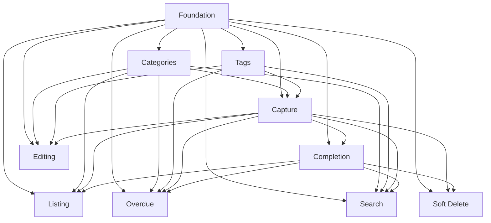

# Todo CLI

## 1. Executive Summary

Todo CLI is a single-user, local-first task manager that runs entirely in the terminal. It is built for developers and other terminal-heavy users who need to capture, organize, and review their tasks without leaving the shell. Every task has a title, optional notes, an optional due date, one flat category, and up to ten tags. All data lives in a local SQLite database; there are no accounts, no network calls, and no synchronization.

The product's core value is speed and focus. A task is captured with one command, today's commitments are shown with one command, and every past-due task is ranked by lateness with one command. Categories and tags provide lightweight structure, and a combined search/filter command makes any task retrievable. Human-readable tables are the default output, while a global `--json` flag makes every read command composable with shell scripts.

At a high level, the tool is a Go binary with a command tree (`add`, `list`, `show`, `done`, `reopen`, `edit`, `overdue`, `search`, `completed`, `categories`, `tags`, `delete`, `restore`, `deleted`). On first use it creates its data directory and applies a versioned SQLite schema. Read views hide soft-deleted tasks, hide completed tasks from open views, and compute "today" from the machine's local timezone at the moment each command runs.

## 2. Problem and Opportunity

### The Problem

**Capture friction causes lost work**
- Switching from a terminal to a browser or mobile app to record a task typically costs 15-25 minutes of regained focus after the interruption.
- Tasks that are not written down within roughly 30 minutes are frequently forgotten or paraphrased inaccurately.
- A large share of small obligations — a review request, a follow-up message, a bill — never reach the task tool at all because the capture step is heavier than the task itself.

**Daily focus is diluted**
- Undifferentiated backlogs of 50-200 items hide what is actually due today; users re-scan the entire list every morning to rebuild their plan.
- Without a default "today" view, users either work from memory or maintain a second ad-hoc list outside the tool.
- Completed and open items mixed together make progress invisible and inflate perceived workload.

**Overdue work silently accumulates**
- Without a ranked overdue view, late tasks blend into the backlog and their age is never surfaced.
- Users discover a task is weeks late only when an external deadline forces the issue.
- The absence of a days-late number prevents honest triage between "one day late" and "one month late".

**Organization collapses into free text**
- Flat notes and checklists do not enforce consistent grouping, so retrieval degrades as the list grows.
- Without reusable tags, near-duplicates proliferate ("urgent", "Urgente", "URGENT") and filters stop being reliable.
- Browsing "all tasks for one area" is impossible when the only structure is a title string.

**SaaS task tools break flow and ownership**
- Account creation, login, and network dependency interrupt terminal-based workflows and fail on offline machines.
- Closed data stores cannot be scripted, audited, or backed up with standard Unix tools.
- Vendor lock-in makes migration expensive and puts long-term task history outside the user's control.

### The Opportunity

Todo CLI addresses each problem with a specific product decision:

- **Capture friction →** one `todo add` command accepts every field at once (title, notes, due date, category, tags) and prints the new task ID immediately, so the task is recorded in a single terminal round-trip.
- **Diluted focus →** `todo list` defaults to open tasks due today, and completed tasks are removed from all open views the moment they are marked done.
- **Invisible overdue work →** `todo overdue` lists every past-due open task sorted by days late, with the oldest task called out in a summary line.
- **Weak organization →** one flat category plus reusable, normalized tags give structure without ceremony; `todo list --category` and `todo search` make any slice retrievable.
- **Tool lock-in →** a single local SQLite file, a static Go binary, and `--json` output on every read command keep data portable and scriptable.

The differentiator is not a new task-management concept; it is the removal of every step between "I remembered something" and "it is recorded and reviewable" for people who already live in a terminal.

## 3. Target Audience

### Primary Users

**The Terminal-Native Developer**
- Works primarily in a shell, tmux, or an editor terminal; resists context switches to GUI tools.
- Captures many small obligations per day (review requests, follow-ups, fixes) and needs sub-second capture.
- Expects Unix composability: plain text by default, JSON on demand, meaningful exit codes, and no login.

**The Overloaded Tech Lead or Consultant**
- Tracks 30-100 open items across several areas (clients, internal work, personal administration).
- Needs to triage by lateness and by area, and to review "what is late" before planning the week.
- Values accurate history and recoverability over rich features; losing a task is worse than missing an integration.

### Behavioral Profile

- Comfortable typing commands and reading tabular terminal output; prefers keyboard-only flows.
- Optimizes for speed and low ceremony; abandons tools that require more than one command per action.
- Wants data ownership and offline operation; distrusts mandatory accounts and cloud sync.
- Works across multiple projects and expects the tool to stay out of the way of existing scripts and workflows.

## 4. Objectives

**Minimize capture friction**
- 100% of task fields (title, notes, due date, category, tags) are settable in a single `todo add` invocation.
- Median end-to-end latency of `todo add` is under 100 ms on a database with 10,000 tasks, measured over 50 consecutive runs on reference hardware (4-core CPU, SSD, Linux).

**Make today's commitment visible instantly**
- `todo list` returns the correct today view in under 200 ms at p95 with 10,000 tasks and 50 categories, measured over 50 consecutive runs on reference hardware.
- The default view contains only open tasks whose due date equals the local date of the invocation.

**Expose every overdue task**
- 100% of open, non-deleted tasks with a due date before today appear in `todo overdue`; 0 tasks with a due date today or later appear, verified against a 200-task fixture with known dates.
- Every overdue row displays a days-late value equal to the calendar-day difference between today and the due date.

**Keep organization consistent**
- 0 dangling category or tag references after 100 randomized rename/delete operations, verified by an integration test with SQLite foreign keys enabled.
- Category and tag names are case-insensitively unique, verified by attempting duplicate creation in automated tests.

**Make deletion reversible**
- 100% of soft-deleted tasks can be restored within 30 days, verified with a mocked clock at day 1 and day 29.
- 0 permanent deletions occur outside the documented 30-day retention purge without an explicit `--yes` flag, verified by command-level tests that reject unconfirmed deletions.

## 5. User Stories

### F01. CLI Foundation and Local Storage
- As a user, I want the first run of any command to create the local database automatically so that I do not have to run a separate setup step
- As a user, I want to see the tool version and schema version so that I can report problems accurately
- As a user, I want a global `--json` flag on every read command so that I can pipe task data into scripts
- As the system, I want schema migrations to run inside a transaction so that a failed upgrade never leaves a half-migrated database
- As a user, I want distinct exit codes for validation errors and unexpected failures so that shell scripts can react correctly

### F02. Categories
- As a user, I want to create categories so that I can group tasks by area of responsibility
- As a user, I want to list categories so that I can see what exists before assigning one
- As a user, I want to rename a category so that I can fix naming without losing task associations
- As a user, I want to be prevented from deleting a category that still has tasks unless I choose where those tasks go so that I do not lose organization by accident

### F03. Tags
- As a user, I want tags to be created automatically when I first use them so that tagging does not require a separate setup step
- As a user, I want to list tags with usage counts so that I can reuse existing tags instead of creating near-duplicates
- As a user, I want to rename a tag and have every task updated so that my vocabulary stays consistent
- As a user, I want to delete a tag and have it removed from all tasks so that stale labels disappear
- As a user, I want tag names normalized to lowercase so that "Urgent" and "urgent" do not become two separate tags

### F04. Task Capture
- As a user, I want to capture a task with one command so that I do not lose it while context-switching
- As a user, I want to set a due date using relative terms like "tomorrow" or "+3d" so that I do not have to compute dates manually
- As a user, I want to assign a category and multiple tags at creation time so that the task is organized from the start
- As a user, I want the created task's ID printed immediately so that I can act on it in the next command
- As a user, I want to add optional multi-line notes so that I can keep context without overloading the title

### F05. Task Completion and Reopening
- As a user, I want to mark one or more tasks as done in a single command so that I can clear a batch quickly
- As a user, I want to reopen a completed task so that I can correct a mistake
- As a user, I want to see my recently completed tasks so that I can confirm what I finished this week
- As a user, I want completed tasks to disappear from open views so that my daily list stays relevant

### F06. Task Listing and Today View
- As a user, I want `todo list` to show only tasks due today so that I see today's commitment without noise
- As a user, I want to list all open tasks so that I can plan beyond today
- As a user, I want to list undated tasks so that I can decide when to schedule them
- As a user, I want to filter open tasks by category so that I can review one area at a time
- As a user, I want to see a task's full details, including notes, so that I have context when I start working
- As a user, I want overdue items visually distinguished so that I notice them immediately

### F07. Task Editing
- As a user, I want to change a task's title, notes, due date, category, or tags so that the task stays accurate as things change
- As a user, I want to remove a due date or a category so that I can unschedule or uncategorize a task
- As a user, I want to add or remove individual tags without replacing the whole set so that tag editing is precise
- As a user, I want to see exactly which fields changed after an edit so that I can verify the update

### F08. Overdue Report
- As a user, I want a single command that lists every past-due open task so that nothing silently rots
- As a user, I want the most overdue task first so that I can triage the worst offenders
- As a user, I want to see how many days each task is late so that I can judge urgency
- As a user, I want a summary count so that I can gauge my backlog size at a glance

### F09. Search and Advanced Filters
- As a user, I want to search titles and notes by text so that I can find a task I only half-remember
- As a user, I want to combine text search with category, tag, status, and date filters so that I can narrow results precisely
- As a user, I want to search within a category so that I can review every task for one area
- As a user, I want to choose the sort order so that I can review tasks by due date, creation date, update date, or title
- As a user, I want JSON output from search so that I can build custom reports

### F10. Soft Delete and Recovery
- As a user, I want to delete a task with a confirmation step so that I do not lose it by mistyping an ID
- As a user, I want deleted tasks to be recoverable for 30 days so that mistakes are reversible
- As a user, I want to list recently deleted tasks so that I can find what I removed
- As a user, I want deleted tasks to disappear from every view immediately so that my lists stay accurate
- As a user, I want old deleted tasks to be purged automatically so that the database does not grow forever

## 6. Functionalities

### F01. CLI Foundation and Local Storage

**Core Scope:**
- Go module and a single `todo` binary built with `make build`, using a Cobra command tree
- SQLite database resolved to `$XDG_DATA_HOME/todo/todo.db`, falling back to `~/.local/share/todo/todo.db`, overridable with `TODO_DB_PATH` or the global `--db` flag
- Schema v1 with `categories`, `tags`, `tasks`, and `task_tags` tables; `tasks` includes `completed_at` and `deleted_at` lifecycle columns
- Versioned migration runner backed by a `schema_migrations` table, applied transactionally
- Global flags: `--json`, `--db`, `--no-color`, `--help`, `--version`
- Exit codes: `0` success, `1` user or validation error, `2` unexpected or system error
- Automatic first-run initialization of the data directory and schema

**Full Scope additions:**
- Shell completion generation for bash, zsh, and fish (`todo completion <shell>`)
- `todo doctor` diagnostics reporting database path, schema version, and SQLite integrity check result
- `config.toml` support for defaults such as the default list view, date display format, and color mode

**Capabilities:**
- Binary name is `todo`; no runtime dependencies beyond the operating system
- SQLite 3.35 or newer, WAL journal mode, foreign keys enabled, 5-second busy timeout
- Database file created with `0600` permissions; data directory created with `0700`
- Supports at least 100,000 tasks without schema changes
- Command startup completes in under 150 ms on reference hardware
- Concurrent invocations are safe: write contention retries up to 3 times with 100 ms backoff before failing
- Schema version is tracked and checked on every invocation; a database newer than the binary is refused
- `--json` produces one JSON document per command on stdout, with errors kept on stderr

**Experience:**
- The first command a user runs creates the data directory and database silently; no setup banner is printed, only the command result
- `todo --version` prints `todo v0.1.0 (schema 1)`
- `todo --help` lists commands grouped as task commands, organization commands, and maintenance commands
- Validation errors print a single line prefixed with `error:` to stderr and exit with code 1; unexpected failures print `error: unexpected failure: <detail>` and exit with code 2
- Successful write commands print a one-line confirmation to stdout; successful read commands print a table or JSON
- `--no-color` disables ANSI styling; color is also disabled automatically when stdout is not a TTY

**Error Handling:**
- Data directory cannot be created: `error: cannot create data directory ~/.local/share/todo: permission denied. Set TODO_DB_PATH to a writable location.` (exit 1)
- Database remains locked after retries: `error: database is locked by another process; try again.` (exit 2)
- Database schema is newer than the binary: `error: database schema v3 is newer than supported v1. Upgrade todo before using this database.` (exit 1)
- Database file is corrupt: `error: database file at <path> failed the integrity check. Back up the file before retrying.` (exit 2)
- Migration fails mid-way: the transaction is rolled back and `error: migration to v2 failed: <reason>. Database left unchanged.` is printed (exit 2)

### F02. Categories

**Provides:**
- Category identity and name (used by F04, F06, F07, F08, F09)

**Core Scope:**
- `todo categories add <name>` to create a category
- `todo categories list` to list category names alphabetically
- `todo categories rename <old> <new>` to rename a category and preserve all task associations
- `todo categories delete <name>` with a guard that refuses deletion while tasks reference the category

**Full Scope additions:**
- Open and total task counts per category in `todo categories list`
- `todo categories merge <source> --into <target>` to combine two categories

**Capabilities:**
- Category name length is 1-40 characters after trimming
- Allowed characters: letters, digits, spaces, hyphens, and underscores; leading and trailing whitespace is trimmed
- Names are case-insensitively unique (`Work` and `work` collide)
- Category assignment is optional; a task may be uncategorized, displayed as `—`
- Deleting a category never deletes tasks; tasks must be reassigned with `--move-to <category>` or detached with `--uncategorize`
- Renaming a category updates every task that references it in a single transaction
- Category deletion and rename are rejected when the target name already exists

**Experience:**
- `todo categories add "Work"` prints `Created category "Work".`
- `todo categories list` prints one name per line, or a three-column `NAME  OPEN  TOTAL` table when counts are enabled in Full Scope
- `todo categories rename "Work" "Job"` prints `Renamed category "Work" to "Job" (14 tasks updated).`
- `todo categories delete "Work"` on an empty category asks `Delete category "Work"? [y/N]` and proceeds only on `y`
- `todo categories delete "Work"` on a category with tasks prints the task counts and refuses until `--move-to` or `--uncategorize` is supplied
- `--yes` skips the interactive confirmation for deletion

**Error Handling:**
- Duplicate name: `error: category "work" already exists as "Work".` (exit 1)
- Invalid name: `error: category name must be 1-40 characters using letters, digits, spaces, hyphens, or underscores.` (exit 1)
- Rename collision: `error: cannot rename "Work" to "Personal": that category already exists.` (exit 1)
- Delete with tasks: `error: cannot delete category "Work": 12 open and 30 completed tasks use it. Re-run with --move-to <category> or --uncategorize.` (exit 1)
- Unknown category: `error: category "Wrok" not found. Did you mean "Work"?` (exit 1)

### F03. Tags

**Provides:**
- Tag names attached to tasks (used by F04, F07, F08, F09)

**Core Scope:**
- Tags are created implicitly by `todo add --tag` and `todo edit --tag`
- `todo tags list` to list existing tags alphabetically
- `todo tags delete <name>` to remove a tag from every task that uses it
- Tag names are normalized to lowercase on input

**Full Scope additions:**
- Open and total usage counts per tag, sorted by usage descending then name
- `todo tags rename <old> <new>` with cascade to all tasks
- `todo tags merge <source> --into <target>`

**Capabilities:**
- Tag name length is 1-24 characters after normalization
- Normalization trims whitespace, lowercases, and converts internal spaces to hyphens
- Allowed pattern after normalization: `^[a-z0-9][a-z0-9_-]{0,23}$`
- Names are case-insensitively unique because of normalization
- A task may carry 0-10 tags
- Deleting a tag removes its task associations in one transaction but never deletes tasks
- Tag deletion requires confirmation unless `--yes` is passed
- Renaming a tag to an existing name is rejected with a suggestion to merge

**Experience:**
- `todo add "Fix login" --tag Urgent` creates the normalized tag `urgent` and prints it in the confirmation line
- `todo tags list` prints tag names, one per line in Core Scope, or a `NAME  OPEN  TOTAL` table in Full Scope
- `todo tags delete urgent` asks `Delete tag "urgent" from 8 tasks? [y/N]`
- Renaming prints `Renamed tag "urgent" to "priority" (8 tasks updated).`

**Error Handling:**
- Invalid name: `error: tag name must be 1-24 characters; use letters, digits, hyphens, or underscores.` (exit 1)
- Too many tags on one task: `error: a task can have at most 10 tags (got 11).` (exit 1)
- Delete without confirmation: `error: refusing to delete tag "urgent" without confirmation. Re-run with --yes.` (exit 1)
- Rename collision: `error: tag "priority" already exists. Use: todo tags merge urgent --into priority` (exit 1)

### F04. Task Capture

**Consumes:**
- F02: category names, to validate the `--category` value
- F03: tag names, to create missing tags and attach them to the task

**Provides:**
- Task records containing id, title, notes, due date, category name, tag names, created_at, and updated_at (used by F05, F06, F07, F08, F09, F10)

**Core Scope:**
- `todo add <title>` with `--notes`, `--due`, `--category`, and repeatable `--tag`
- Validation of title, notes, due date, category, and tag count
- Relative due-date parsing for `today`, `tomorrow`, `yesterday`, `+Nd`, `+Nw`, weekday abbreviations, and `YYYY-MM-DD`
- Immediate display of the new task ID and its stored fields

**Full Scope additions:**
- Batch capture from stdin with `--stdin`, reading one title per line
- Duplicate warning when an open task with the same normalized title and due date already exists
- Preset defaults loaded from `config.toml`

**Capabilities:**
- Title is required, 1-200 characters after trimming; whitespace-only titles are rejected
- Notes are optional, up to 2,000 characters, and support embedded newlines
- Due date is optional; accepted range is 1970-01-01 through today + 10 years
- Past due dates are accepted and the task becomes overdue immediately
- `today` resolves to the local date at invocation time; `tomorrow` and `yesterday` are ±1 calendar day
- `+Nd` and `+Nw` add N calendar days or weeks; `+0d` equals today
- Weekday abbreviations (`mon` through `sun`) resolve to the next occurrence strictly after today, never today itself
- Category must already exist; omitting it creates an uncategorized task
- Tags are created on first use, attached to the task, and capped at 10 per task
- Task IDs are monotonically increasing integers and are never reused, including after deletion or purge
- A task captured with a due date equal to today appears in the next `todo list` invocation
- `--json` returns the full task object with `id`, `title`, `notes`, `due`, `category`, `tags`, `status`, `created_at`, and `updated_at`

**Experience:**
- `todo add "Pay electricity bill" -d tomorrow -c Home -t bills -t urgent` prints:
  ```
  Created #42  Pay electricity bill
    Due: 2026-11-12  Category: Home  Tags: bills, urgent
  ```
- When no due date, category, or tags are provided, the corresponding line is omitted rather than printed empty
- The confirmation line is printed to stdout; `--json` prints a single object instead
- The due date is stored as a calendar date in the local timezone; no time of day is accepted or displayed
- Notes are entered with `--notes "text"` or `--notes -` to read from stdin in Full Scope
- Invalid input fails before any write; no partial task is created

**Error Handling:**
- Missing or invalid title: `error: title is required and must be 1-200 characters.` (exit 1)
- Unparseable date: `error: invalid due date "next tuesday-ish". Accepted: YYYY-MM-DD, today, tomorrow, yesterday, +Nd, +Nw, mon..sun.` (exit 1)
- Unknown category: `error: category "Hme" not found. Did you mean "Home"? Create it with: todo categories add "Hme"` (exit 1)
- Too many tags: `error: a task can have at most 10 tags (got 11).` (exit 1)
- Notes too long: `error: notes exceed 2,000 characters (2,431).` (exit 1)

### F05. Task Completion and Reopening

**Consumes:**
- F04: task records with id, title, due date, category name, and tag names, to identify and validate the tasks being completed

**Provides:**
- Completion status (`open` or `completed`) and completed_at timestamp for each task (used by F06, F08, F09, F10)

**Core Scope:**
- `todo done <id...>` to mark 1-50 tasks as completed
- `todo reopen <id...>` to return completed tasks to the open state
- `todo completed` archive view of completed tasks

**Full Scope additions:**
- Bulk completion by filter, for example `todo done --category Work --due-before today --yes`
- `todo undo` to reverse the most recent completion or reopen operation

**Capabilities:**
- `done` and `reopen` accept between 1 and 50 task IDs per invocation
- All IDs are validated before any write; if one ID is invalid, no task changes
- Completion sets `completed_at` to the current UTC timestamp and records it once; repeating the command does not change the original timestamp
- Completing an already-completed task prints a notice and exits with code 0
- Reopening preserves the task's due date, category, and tags
- Reopening a task whose due date has passed makes it appear in `todo overdue` on the next invocation
- Completed tasks are excluded from `todo list`, `todo list --all`, `todo list --undated`, and `todo overdue`
- `todo completed` shows the last 30 days by default, newest completion first, capped at 50 rows
- `todo completed --all` shows the entire archive; `--since YYYY-MM-DD` and `--limit N` refine the view
- Completed tasks retain their category and tags
- The completed view shows columns `ID`, `TITLE`, `COMPLETED`, `CATEGORY`, `TAGS`

**Experience:**
- `todo done 42 43` prints one line per task:
  ```
  Completed #42  Pay electricity bill
  Completed #43  Review PR #128
  ```
- `todo reopen 43` prints `Reopened #43  Review PR #128 (due 2026-11-11, due today).`
- `todo completed` prints the archive table, or `No tasks completed in the last 30 days.` when empty
- Repeating `todo done 42` prints `note: #42 already completed on 2026-11-10.` and exits 0
- `--json` returns an array of task objects with completion fields

**Error Handling:**
- Unknown ID in the batch: `error: task #99 not found. No tasks were changed.` (exit 1)
- Deleted task: `error: task #42 is deleted. Restore it first with: todo restore 42` (exit 1)
- Batch too large: `error: too many IDs (51); maximum is 50 per command.` (exit 1)
- Write failure: `error: failed to update 2 tasks; no changes were applied.` (exit 2)
- Already completed (non-fatal): `note: #43 already completed on 2026-11-10.` (exit 0)

### F06. Task Listing and Today View

**Consumes:**
- F04: task records with id, title, notes, due date, category name, tag names, and created_at, excluding soft-deleted tasks
- F05: completion status and completed_at, to hide completed tasks from open views
- F02: category names, to validate and apply the `--category` filter

**Core Scope:**
- `todo list` showing open tasks due today
- `todo list --all` showing every open task
- `todo list --undated` showing open tasks with no due date
- `todo list --category <name>` showing open tasks in one category
- `todo show <id>` showing full task details
- Table output and `--json` output

**Full Scope additions:**
- Configurable default view in `config.toml` (today, all, or undated)
- Relative due labels such as "in 3 days" and "2 days late"
- Category grouping headers in table output

**Capabilities:**
- "Today" is the local calendar date computed once at the start of the invocation
- Default `todo list` shows only open tasks whose due date equals today, sorted by category name ascending with uncategorized last, then by ID ascending
- `todo list --all` shows all open tasks sorted by due date ascending with undated tasks last, then by ID ascending
- `todo list --undated` shows open tasks without a due date, sorted by created_at ascending
- `todo list --category <name>` shows open tasks in that category sorted by due date ascending with undated last, then by ID ascending
- `--category` combines with `--all` and `--undated`; combining with the default today view filters today's tasks by category
- Table columns are `ID`, `TITLE`, `DUE`, `CATEGORY`, and `TAGS`; empty values display as `—`
- Title is truncated with `…` so the row fits the terminal width
- Below 80 columns the `TAGS` column is hidden; below 60 columns the `CATEGORY` column is hidden
- Overdue due dates are rendered in red and due-today dates in bold yellow when color is enabled
- Empty today view prints `No tasks due today. Add one with: todo add "..." -d today`
- Empty all view prints `No open tasks.`
- `todo show <id>` prints title, status, due date, category, tags, created and updated timestamps, days overdue when applicable, and the notes block when notes exist
- `--json` returns an array of task objects for list views and a single object for `show`

**Experience:**
- `todo list` output:
  ```
  ID   TITLE                          DUE         CATEGORY   TAGS
  42   Pay electricity bill           2026-11-11  Home       bills, urgent
  43   Review PR #128                 2026-11-11  Work       code-review
  ```
- `todo show 42` output:
  ```
  #42  Pay electricity bill
  Status:    open
  Due:       2026-11-11
  Category:  Home
  Tags:      bills, urgent
  Created:   2026-11-09 14:02
  Updated:   2026-11-09 14:02

  Notes:
  Account 88213, due by end of day.
  ```
- Unknown category names in `--category` produce `error: category "Wrok" not found. Did you mean "Work"?` and exit 1
- Completed tasks never appear in any `list` variant
- Soft-deleted tasks never appear in any `list` variant

### F07. Task Editing

**Consumes:**
- F04: task records with id, title, notes, due date, category name, tag names, created_at, and updated_at
- F02: category names, to validate a new `--category` value
- F03: tag names, to add or remove tags and enforce the 10-tag cap

**Core Scope:**
- `todo edit <id>` with `--title`, `--notes`, `--due`, `--no-due`, `--category`, `--no-category`, `--tag`, `--untag`, and `--clear-tags`
- Partial updates that change only the supplied fields
- A diff summary of the fields that changed

**Full Scope additions:**
- `--append-notes` to append text to existing notes instead of replacing them
- Bulk edit by filter, for example `todo edit --category Work --set-category Job --yes`

**Capabilities:**
- Exactly one task ID is accepted per invocation in Core Scope
- At least one mutation flag is required; invoking `todo edit 42` alone prints the current values and exits 0
- `--due` accepts the same formats as F04
- `--no-due` removes the due date; `--no-category` clears the category
- `--tag` adds one tag and creates it if missing; repeating `--tag` adds several
- `--untag` removes one tag; removing a tag that is not attached prints a notice and exits 0
- `--clear-tags` removes all tags from the task
- Adding a tag beyond the 10-tag cap fails before any write
- Editing a completed task is allowed and does not change its completion status
- Editing a deleted task is rejected with a restore hint
- `updated_at` is refreshed only when at least one field actually changes
- The diff summary lists old and new values for every changed field

**Experience:**
- `todo edit 42 -d +3d -c Work --tag finance` prints:
  ```
  Updated #42  Pay electricity bill
    Due:      2026-11-11 → 2026-11-14
    Category: Home → Work
    Tags:     bills, urgent → bills, urgent, finance
  ```
- `todo edit 42 --no-due` prints `Updated #42  Pay electricity bill` followed by `Due: 2026-11-14 → (none)`
- `todo edit 42` with no flags prints the current task details and `note: no changes specified.`
- `--json` returns the updated task object plus a `changes` object keyed by field name

**Error Handling:**
- Unknown task: `error: task #99 not found.` (exit 1)
- Deleted task: `error: task #42 is deleted. Restore it first with: todo restore 42` (exit 1)
- Invalid date: `error: invalid due date "someday". Accepted: YYYY-MM-DD, today, tomorrow, yesterday, +Nd, +Nw, mon..sun.` (exit 1)
- Unknown category: `error: category "Wrok" not found. Did you mean "Work"?` (exit 1)
- Tag cap exceeded: `error: a task can have at most 10 tags; remove one with --untag before adding another.` (exit 1)
- Write failure: `error: failed to update task #42; no changes were applied.` (exit 2)

### F08. Overdue Report

**Consumes:**
- F04: task records with id, title, due date, category name, and tag names
- F05: completion status, to include only open tasks
- F02: category names for display
- F03: tag names for display

**Core Scope:**
- `todo overdue` listing every open task with a due date before today
- Sorting by days late descending, then due date ascending, then ID ascending
- A summary line with the overdue count and the oldest task
- `--limit N` and `--json` support

**Full Scope additions:**
- `--min-days N` to show only tasks at least N days late
- `--category <name>` to scope the report to one category
- A per-category summary section after the table

**Capabilities:**
- "Today" is the local calendar date computed once at invocation time
- A task is overdue when its due date is strictly before today and its status is open
- Days late equals today minus due date in whole calendar days, with a minimum of 1
- Tasks due today are never included
- Completed tasks are never included
- Soft-deleted tasks are never included
- Default output has no row cap; `--limit N` accepts 1-500 and truncates the list while keeping the summary accurate
- Table columns are `ID`, `TITLE`, `DUE`, `DAYS LATE`, `CATEGORY`, and `TAGS`
- Summary line format: `N overdue tasks; oldest X days late (task #ID).`
- Empty result prints `No overdue tasks.`
- `--json` returns an array of task objects including `days_late`

**Experience:**
- `todo overdue` output:
  ```
  ID   TITLE                     DUE         DAYS LATE  CATEGORY   TAGS
  17   Renew domain              2026-10-15  27         Infra      billing
  31   File quarterly report     2026-11-01  10         Work       finance, urgent
  42   Book dentist              2026-11-09  2          Personal   health

  3 overdue tasks; oldest 27 days late (task #17).
  ```
- `todo overdue --limit 1` prints the single most overdue row followed by `1 of 3 overdue tasks shown; oldest 27 days late (task #17).`
- `--json` emits the same summary as a `summary` object alongside the `tasks` array
- Ordering is deterministic across invocations for identical data and date

### F09. Search and Advanced Filters

**Consumes:**
- F04: task records with title, notes, due date, category name, tag names, created_at, and updated_at
- F05: completion status, for the `--status` filter
- F02: category names, for the `--category` filter
- F03: tag names, for the `--tag` filter

**Capabilities:**
- `todo search <query>` performs a case-insensitive literal substring match over title and notes
- Omitting the query is allowed when at least one filter is supplied
- Query length is 0-200 characters; longer queries are rejected
- Filters combine with AND semantics: `--category`, `--tag` (repeatable, all listed tags must be present), `--status open|completed|all` (default `open`), `--due-from`, `--due-to`, `--undated`, and `--overdue`
- `--due-from` and `--due-to` accept `YYYY-MM-DD` and the relative formats `today`, `tomorrow`, `yesterday`, `+Nd`, and `+Nw`
- `--overdue` is equivalent to `--due-to yesterday` combined with open status
- Results are sorted by due date ascending with undated last, then ID ascending, by default
- `--sort due|created|updated|title` changes the sort field; `--reverse` inverts the order
- Results are capped at 500 rows; when truncated, the footer reads `Showing 500 of N results. Narrow your filters.`
- Empty result prints `No tasks match "<query>" with the selected filters.`
- `--json` returns an array of task objects
- Search never includes soft-deleted tasks
- Search is literal: no regular expressions, wildcards, or fuzzy matching

**Experience:**
- `todo search invoice --tag urgent --status open` returns matching open tasks with all filters applied
- `todo search --category Work --overdue` returns every overdue task in the Work category
- `todo search "domain" --status all --sort updated --reverse` returns both open and completed matches, most recently updated first
- Filter values that do not exist produce a validation error rather than an empty result: `error: tag "urgnet" not found. Did you mean "urgent"?`
- `--json` output is identical in shape to the `todo list --json` task objects

### F10. Soft Delete and Recovery

**Consumes:**
- F04: task records with id and title
- F05: completion status and completed_at, so restored tasks return to their prior state

**Core Scope:**
- `todo delete <id...>` performing a soft delete with confirmation
- `todo deleted` listing recoverable tasks
- `todo restore <id...>` restoring soft-deleted tasks
- Automatic purge of tasks deleted more than 30 days ago

**Full Scope additions:**
- Bulk delete by filter, for example `todo delete --category Archive --before 2026-01-01 --yes`
- `todo purge <id...> --yes` to permanently delete a task immediately, bypassing retention
- Configurable retention period in `config.toml`

**Capabilities:**
- `delete` and `restore` accept 1-50 task IDs per invocation
- Deletion sets `deleted_at` and hides the task from every view immediately
- Deletion requires interactive confirmation listing the affected titles unless `--yes` is supplied
- All IDs are validated before any write; one invalid ID aborts the whole batch
- `todo deleted` shows `ID`, `TITLE`, `DELETED`, and `DAYS LEFT` columns, capped at 50 rows by default; `--all` shows everything
- `DAYS LEFT` is `30 - (today - deleted_at)`, floored at 0
- `todo restore` clears `deleted_at`; a previously completed task remains completed and returns to the completed archive
- A restored task with a past due date reappears in `todo overdue` immediately
- Auto-purge runs at most once every 24 hours, on any command that opens the database, and permanently removes tasks whose `deleted_at` is more than 30 days old
- Auto-purge prints `note: purged N tasks deleted more than 30 days ago.` to stderr
- Task IDs remain reserved after purge and are never reused
- Deleting a task does not delete its category or tags

**Experience:**
- `todo delete 42` prints the task title and asks `Delete #42 "Pay electricity bill"? It can be restored for 30 days. [y/N]`
- `todo delete 42 --yes` prints `Deleted #42  Pay electricity bill (restorable for 30 days).`
- `todo deleted` output:
  ```
  ID   TITLE                     DELETED      DAYS LEFT
  57   Old draft task            2026-11-08   27
  ```
- `todo restore 57` prints `Restored #57  Old draft task.`
- Deleting an already deleted task prints `note: #57 already deleted on 2026-11-08.` and exits 0
- `--json` returns the affected task objects with `deleted_at` and `days_left`

**Error Handling:**
- Unknown ID in the batch: `error: task #99 not found. No tasks were changed.` (exit 1)
- Missing confirmation: `error: refusing to delete 2 tasks without confirmation. Re-run with --yes.` (exit 1)
- Restore of a non-deleted task: `error: task #42 is not deleted.` (exit 1)
- Purge without confirmation: `error: permanent purge requires --yes.` (exit 1)
- Write failure: `error: failed to delete 2 tasks; no changes were applied.` (exit 2)

## 7. Out of Scope

### Collaboration and Accounts
- User accounts, login, authentication, and multi-user support
- Task sharing, assignment to other people, comments, and activity feeds
- Cloud synchronization and multi-device data replication

### Task Model Extensions
- Subtasks, checklists, and parent-child task relationships
- Recurring tasks (daily, weekly, monthly) and automatic regeneration
- Priority levels and custom task fields
- Task dependencies, blockers, and time tracking
- File attachments and inline images

### Interface and Notifications
- Graphical interfaces: web, mobile, desktop, and TUI dashboards
- Interactive task browsers, kanban boards, and calendar views
- Desktop notifications, reminders, and scheduled alerts

### Data Exchange and Integration
- Import from or export to Todoist, CSV, JSON bulk formats, or other task tools
- A server mode, HTTP API, or plugin system
- Calendar and issue-tracker integrations

### Advanced Input and Search
- Full natural-language parsing such as "next friday at 3pm" or "in two weeks"
- Regular-expression search, fuzzy matching, and semantic search
- Encryption at rest and encrypted backups

### Distribution
- OS-specific installers and automatic update mechanisms
- Package manager publication (Homebrew, AUR, apt, and similar)

## 8. Dependency Graph

| # | Feature | Priority | Dependencies |
|---|---------|----------|--------------|
| F01 | CLI Foundation and Local Storage | 1 | None |
| F02 | Categories | 1 | F01 |
| F03 | Tags | 1 | F01 |
| F04 | Task Capture | 1 | F01, F02, F03 |
| F05 | Task Completion and Reopening | 1 | F01, F04 |
| F06 | Task Listing and Today View | 1 | F01, F02, F04, F05 |
| F07 | Task Editing | 1 | F01, F02, F03, F04 |
| F08 | Overdue Report | 1 | F01, F02, F03, F04, F05 |
| F09 | Search and Advanced Filters | 2 | F01, F02, F03, F04, F05 |
| F10 | Soft Delete and Recovery | 2 | F01, F04, F05 |

### Foundation Features
These features set up shared project infrastructure. In a greenfield project they must be implemented sequentially before or alongside any feature that depends on them:
- **F01 CLI Foundation and Local Storage** — scaffolds the Go module and Cobra command tree, defines global flags and exit-code conventions, initializes the SQLite schema and migration runner, and resolves the local data directory.

### Execution Waves
Features within the same wave can be built in parallel. A wave starts only after every feature in earlier waves is complete.

**Note:** Foundation features (see "Foundation Features" above) cannot run in parallel in a greenfield project even if they appear together in a wave — they share scaffolding files and must be implemented sequentially until the base is in place.

- **Wave 1**: F01
- **Wave 2**: F02, F03
- **Wave 3**: F04
- **Wave 4**: F05, F07
- **Wave 5**: F06, F08, F09, F10

### Priority levels
- **1** = Essential — product does not work without it
- **2** = Important — significant value addition
- **3** = Desirable — incremental improvement



## 9. Acceptance Criteria

### F01. CLI Foundation and Local Storage
- [ ] Running any command for the first time creates the data directory and database without a separate setup command
- [ ] `todo --version` prints both the binary version and the schema version
- [ ] Every read command supports `--json` and emits output that parses with `jq`
- [ ] A migration that fails midway leaves the schema version and data unchanged
- [ ] An unwritable data directory produces the documented error message and exit code 1
- [ ] 20 concurrent write commands complete without database corruption or lost updates

### F02. Categories
- [ ] A category can be created, listed, renamed, and deleted
- [ ] Creating a category whose name differs only by case is rejected
- [ ] Renaming a category updates the category shown for every associated task
- [ ] Deleting a category with tasks is refused unless `--move-to` or `--uncategorize` is supplied
- [ ] `--move-to` reassigns every task to the target category in one transaction
- [ ] Deleting an empty category with confirmation removes it and leaves all tasks intact

### F03. Tags
- [ ] Using a tag for the first time creates it automatically and attaches it to the task
- [ ] `Urgent` and `urgent` resolve to the same tag
- [ ] Attaching an 11th tag to a task is rejected and no tag is added
- [ ] Deleting a tag removes it from every task without deleting any task
- [ ] Renaming a tag updates every task that carries it

### F04. Task Capture
- [ ] A task can be created with title, notes, due date, category, and up to 10 tags in one command
- [ ] With a fixed clock, `today`, `tomorrow`, `yesterday`, `+3d`, `+2w`, and weekday abbreviations resolve to the expected dates
- [ ] Weekday input that matches the current weekday resolves to the same weekday in the following week
- [ ] A task with a past due date is accepted and immediately reported as overdue
- [ ] Invalid title, date, category, or tag count produces the documented error and creates no task
- [ ] Task IDs increase monotonically and are never reused after deletion

### F05. Task Completion and Reopening
- [ ] Multiple tasks can be completed in one command and each receives a completed_at timestamp
- [ ] Completing an already-completed task prints a notice and exits 0 without changing completed_at
- [ ] A batch containing one invalid ID changes no tasks
- [ ] Completed tasks disappear from today, all, undated, and overdue views
- [ ] `todo completed` lists completed tasks newest first and defaults to the last 30 days
- [ ] Reopening a task restores it to open views and keeps its due date, category, and tags

### F06. Task Listing and Today View
- [ ] Default `todo list` shows only open tasks whose due date equals today
- [ ] `todo list --all` shows all open tasks with undated tasks last
- [ ] `todo list --undated` shows only open tasks without a due date
- [ ] `todo list --category Work` shows only open tasks in the Work category
- [ ] Completed and soft-deleted tasks never appear in any list variant
- [ ] `todo show <id>` displays notes, timestamps, and days overdue when applicable
- [ ] List and show output parse correctly with `--json`

### F07. Task Editing
- [ ] Supplying one field flag changes only that field and refreshes updated_at
- [ ] `--no-due` removes the due date and `--no-category` clears the category
- [ ] `--tag` and `--untag` add and remove individual tags without affecting other tags
- [ ] The diff summary lists every changed field with its old and new value
- [ ] Editing a deleted task is refused with a restore hint
- [ ] An edit that exceeds the 10-tag cap makes no changes

### F08. Overdue Report
- [ ] Every open task with a due date before today appears in `todo overdue`
- [ ] No task due today or later appears in `todo overdue`
- [ ] Rows are ordered by days late descending, then due date ascending, then ID ascending
- [ ] Days late equals the calendar-day difference between today and the due date
- [ ] The summary line reports the total count and the oldest task correctly
- [ ] `--limit` truncates rows while the summary still reports the full count

### F09. Search and Advanced Filters
- [ ] A text query matches case-insensitive substrings in titles and in notes
- [ ] Multiple filters combine with AND semantics
- [ ] `--tag` with two tags returns only tasks carrying both tags
- [ ] `--status completed` returns completed tasks only, and `--status all` returns both states
- [ ] `--sort` and `--reverse` produce the documented ordering
- [ ] Results are capped at 500 with the truncation footer when more matches exist
- [ ] Soft-deleted tasks never appear in search results

### F10. Soft Delete and Recovery
- [ ] Deleting a task with confirmation hides it from every view immediately
- [ ] Deleting without confirmation in a non-interactive shell fails unless `--yes` is supplied
- [ ] A batch containing one invalid ID deletes no tasks
- [ ] A restored task returns to its prior completion status and reappears in due views
- [ ] With a mocked clock, a task deleted 29 days ago is still listed and restorable
- [ ] With a mocked clock, a task deleted 31 days ago is purged on the next command and is not restorable
- [ ] Auto-purge never removes a task that is not soft-deleted

### Cross-Feature Integration
- [ ] A category created through F02 can be assigned during capture in F04 and appears in that task's row in `todo list` (F06)
- [ ] A tag first used during capture in F04 is created by F03, attached to the task, and displayed by `todo list` (F06) and `todo overdue` (F08)
- [ ] A task captured in F04 with a due date of today appears in the default `todo list` (F06) on the next invocation
- [ ] Completing a task in F05 removes it from the today and all views of F06 and from the overdue report of F08
- [ ] A task completed in F05 appears in `todo completed` with its category and tags intact
- [ ] The `--category` filter in F06 accepts exactly the category names provided by F02 and rejects unknown names with a suggestion
- [ ] Editing a due date in F07 is reflected in the today view of F06 and in the days-late ranking of F08 on the next invocation
- [ ] A title or category changed in F07 is reflected in the task's row in F06 and F08 on the next invocation
- [ ] Editing tags in F07 is reflected by the tag filters of F09 without restarting the process
- [ ] Renaming a category in F02 updates the category name displayed by F06, F08, and F09 for every associated task
- [ ] The overdue report in F08 excludes every task marked completed by F05 and includes every open past-due task captured by F04
- [ ] Category and tag names provided by F02 and F03 render correctly in the overdue table of F08
- [ ] Search results in F09 honor the completion status written by F05 and the category and tag entities provided by F02 and F03
- [ ] A task deleted through F10 disappears from F06, F08, and F09, and restoring it makes it reappear with the completion status recorded by F05
